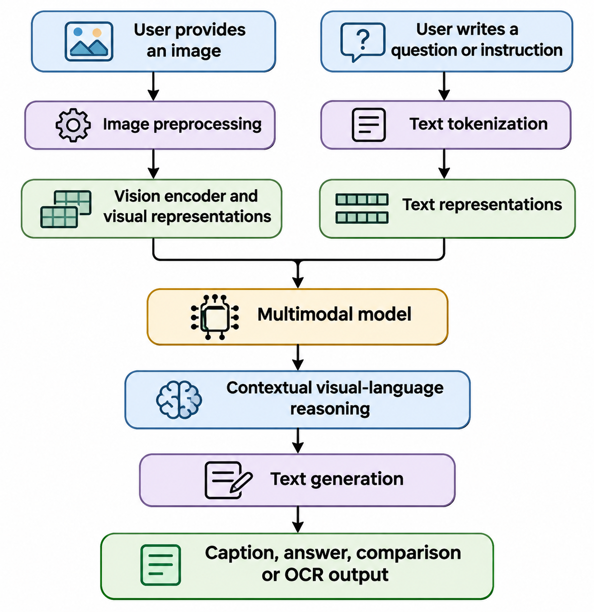
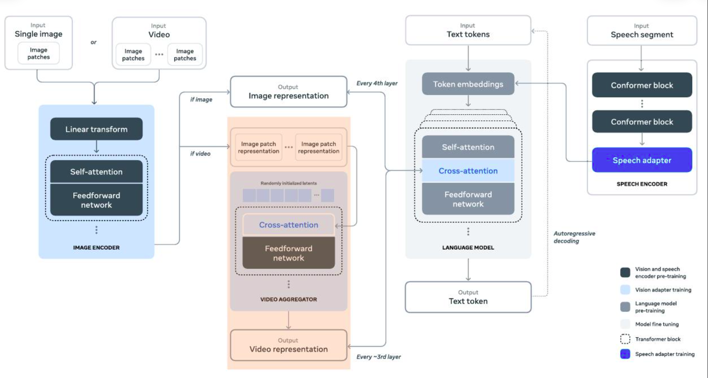
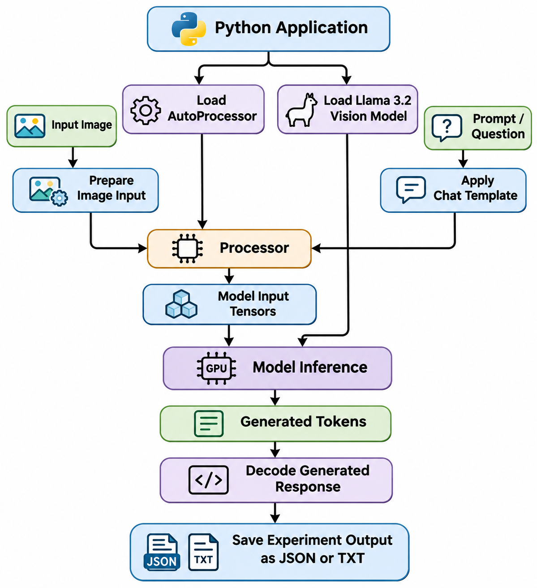
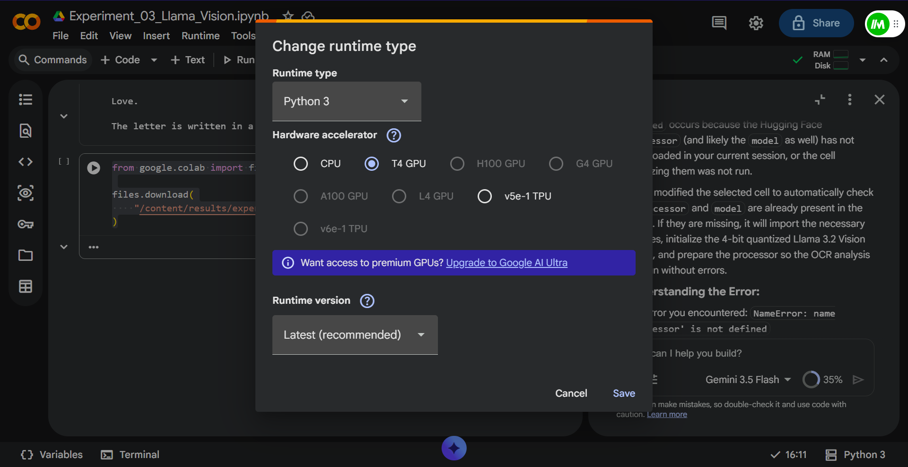
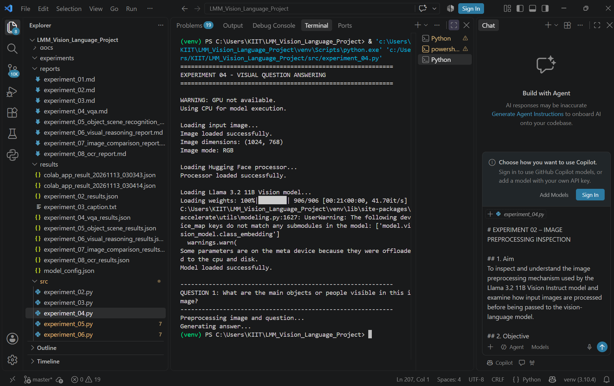
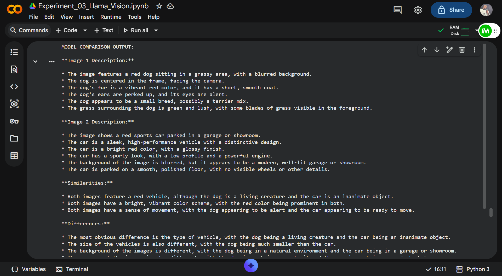
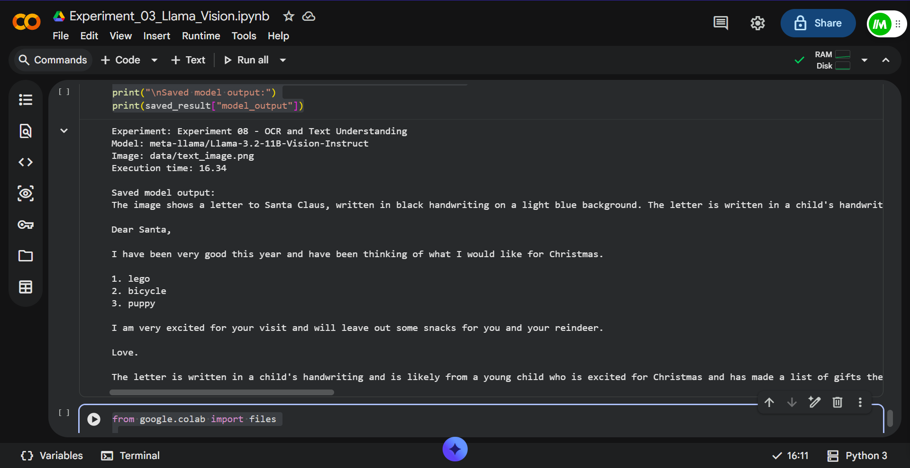
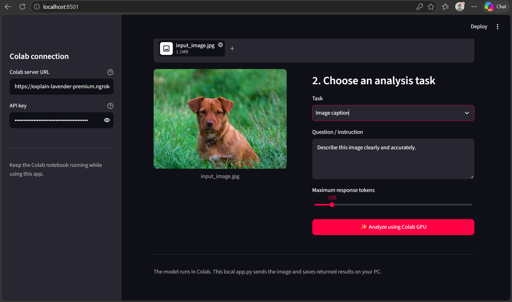

# Exploring Large Multimodal Models: Vision-Language Understanding with Llama 3.2 Vision

**An experimental study of image understanding, visual reasoning and text extraction using a Large Multimodal Model**

**Author:** Abhinash Rout  
**Project:** Large Multimodal Models (LMMs) / Vision-Language Models (VLMs)  
**Model:** Meta Llama 3.2 11B Vision Instruct  
**Repository:** [LMM-Vision-Language-Project](https://github.com/abhinash7729/LMM-Vision-Language-Project)

---

## Abstract

Large Multimodal Models (LMMs) extend traditional language models by enabling them to process and reason about information from multiple modalities, including text and images. This project explores the capabilities of Meta's Llama 3.2 11B Vision Instruct model through a sequence of eight practical experiments.

The experiments investigate model configuration and image preprocessing, image caption generation, Visual Question Answering (VQA), object and scene recognition, visual reasoning, cross-image comparison, and Optical Character Recognition (OCR).

The project uses Python and the Hugging Face Transformers ecosystem. Experiments were conducted using a local Windows development environment and Google Colab. Recorded GPU experiments used an NVIDIA Tesla T4 with 4-bit model quantization.

The results demonstrate that the model can generate image descriptions, answer questions about visual content, identify scene elements, compare images, and extract text from a handwritten letter. The experiments also reveal limitations involving incomplete responses, unsupported inferences, and visual reasoning errors.

## 1. Introduction

Traditional language models primarily process textual information. Vision-Language Models combine visual and linguistic processing to understand images and respond to natural-language instructions.

A user can provide an image and ask questions such as:

- What objects are visible?
- What is happening in the image?
- Describe the surroundings.
- Compare two images.
- Extract the text from a photograph.
- Explain the relationships between objects.

This project investigates these capabilities using **Llama 3.2 11B Vision Instruct**, a vision-language model available through Hugging Face.

The objective is not only to demonstrate model inference but also to evaluate its outputs, document its limitations, and understand how multimodal inference works in practice.

## 2. Project objectives

1. Understand the configuration and architecture of a vision-language model.
2. Explore image preprocessing and model input preparation.
3. Generate natural-language image captions.
4. Perform Visual Question Answering.
5. Identify objects and classify scenes.
6. Explore visual reasoning and relationships between objects.
7. Compare two images using a single model.
8. Extract and summarize text from an image using OCR-style prompting.
9. Record execution time, hardware configuration, and model outputs.
10. Evaluate the strengths and limitations of multimodal AI.

## 3. Model information

| Property | Details |
|---|---|
| Model name | Llama 3.2 11B Vision Instruct |
| Organization | Meta |
| Hugging Face model ID | `meta-llama/Llama-3.2-11B-Vision-Instruct` |
| Model category | Large Multimodal Model / Vision-Language Model |
| Input modalities used | Images and text |
| Output modality | Generated text |
| Model loading class | `MllamaForConditionalGeneration` |
| Processor | `AutoProcessor` |
| Framework | Hugging Face Transformers |
| GPU used in recorded GPU experiments | NVIDIA Tesla T4 |
| Quantization in recorded GPU experiments | 4-bit |

**Model resource:** [Llama 3.2 11B Vision Instruct on Hugging Face](https://huggingface.co/meta-llama/Llama-3.2-11B-Vision-Instruct)

The model is gated on Hugging Face. Users must satisfy the model access conditions and authenticate before downloading it.

## 4. How does the model work?

A vision-language model receives visual information and a natural-language instruction. The image is processed into visual representations, while the text instruction is converted into model input tokens. The model uses the combined context to generate a response.

### 4.1 High-level model workflow

## Model Workflow




## High-Level Model Workflow



### 4.2 Project inference workflow

## Model Workflow



The diagrams describe the project's high-level workflow. They are conceptual representations, not a layer-by-layer reconstruction of Meta's internal model architecture.

### 4.3 Main components

**Image input:** The image is opened and prepared using Pillow.

**Processor:** `AutoProcessor` prepares the image and text inputs in the format expected by the model.

**Chat template:** The model's chat template structures the instruction and multimodal conversation.

**Vision-language model:** `MllamaForConditionalGeneration` performs multimodal inference.

**Text generation:** The model generates tokens in response to the supplied image and prompt.

**Output decoding:** The generated tokens are decoded into readable text and saved for evaluation.

## 5. Hardware and software configuration

The project used two execution environments.

### 5.1 Local development environment

| Configuration | Details |
|---|---|
| Operating system | Windows |
| Development environment | Visual Studio Code |
| Programming language | Python |
| Processor | Local system CPU |
| RAM | 16 GB |
| GPU | AMD GPU |
| PyTorch CUDA support | Not available in the previously tested local setup |

The local environment was useful for development and testing. However, CPU-based inference for the large vision model could be slow.

### 5.2 Google Colab environment

Recorded GPU experiments used:

| Configuration | Recorded value |
|---|---|
| Platform | Google Colab |
| GPU | NVIDIA Tesla T4 |
| CUDA availability | Yes |
| Quantization | 4-bit |
| Model | Llama 3.2 11B Vision Instruct |

The recorded Tesla T4 configuration applies specifically to Experiments 07 and 08. The saved records for Experiments 05 and 06 do not specify their execution device.

## Google Colab GPU




### 5.3 Main Python dependencies

The project uses the following libraries:

```bash
pip install torch
pip install transformers
pip install accelerate
pip install bitsandbytes
pip install pillow
pip install huggingface_hub
pip install streamlit
pip install requests
```

Not every package is required for every experiment. For example, Streamlit and Requests are relevant to the optional application interface and remote inference workflow.

### 5.4 Model configuration example

The following is an illustrative configuration for loading the model with 4-bit quantization in a compatible CUDA environment.

```python
import torch

from transformers import (
    AutoProcessor,
    MllamaForConditionalGeneration,
    BitsAndBytesConfig
)

MODEL_ID = "meta-llama/Llama-3.2-11B-Vision-Instruct"

quantization_config = BitsAndBytesConfig(
    load_in_4bit=True
)

processor = AutoProcessor.from_pretrained(MODEL_ID)

model = MllamaForConditionalGeneration.from_pretrained(
    MODEL_ID,
    quantization_config=quantization_config,
    device_map="auto"
)

print("Model loaded successfully")
```

**Important:** This is a representative configuration, not a claim that every experiment used identical loading settings. The local Experiment 03 implementation used `torch_dtype="auto"`, `device_map="auto"` and `low_cpu_mem_usage=True`. Experiments 07 and 08 recorded 4-bit quantization on a Tesla T4.

### 5.5 Inference configuration

The general inference process uses a prompt and one or more images.

```python
messages = [
    {
        "role": "user",
        "content": [
            {"type": "image"},
            {
                "type": "text",
                "text": "Describe the contents of this image."
            }
        ]
    }
]

prompt = processor.apply_chat_template(
    messages,
    add_generation_prompt=True
)

inputs = processor(
    image,
    prompt,
    return_tensors="pt"
)

output = model.generate(
    **inputs,
    max_new_tokens=150
)

response = processor.decode(
    output[0],
    skip_special_tokens=True
)

print(response)
```

The exact input placement and device handling may differ depending on the model-loading and Transformers configuration used in an experiment.

## 6. Experiment descriptions and results

### Experiment 01 — Model and Environment Inspection

**Objective:** Inspect the model configuration and architecture before running visual tasks.

**Main implementation:** `src/inspect_model.py`  
**Expected output:** `results/model_config.json`

The experiment was designed to inspect the model configuration and establish the model-loading workflow.

The configuration inspection is an important initial step because it helps identify the model architecture and the settings needed for inference.

**Evaluation:** The project contains an implementation for model inspection. Detailed configuration values and measured findings are not reproduced here because the complete result file was not available for this article.

### Experiment 02 — Image Preprocessing Inspection

**Objective:** Examine how an image is prepared before it is passed to the vision-language model.

**Main implementation:** `src/experiment_02.py`  
**Expected output:** `results/experiment_02_results.json`

Image preprocessing is an important part of multimodal inference. The input image must be converted into the representation expected by the model's processor.

This experiment was designed to inspect the preprocessing workflow before performing higher-level image understanding.

**Evaluation:** The experiment's implementation and expected output path are documented. Specific preprocessing measurements are not included because the complete result file was not available for this article.

### Experiment 03 — Image Understanding and Caption Generation

**Objective:** Generate a natural-language description of an input image.

**Model:** `meta-llama/Llama-3.2-11B-Vision-Instruct`

The implementation loads the model and processor, prepares an image, applies the model's chat template, and generates a caption.

**Recorded implementation settings:**

- Image resized to 1024 × 1024.
- `torch_dtype="auto"`.
- `device_map="auto"`.
- `low_cpu_mem_usage=True`.
- `max_new_tokens=50`.

**Output file:** `results/experiment_03_caption.txt`

The user confirmed that the script ran successfully in Visual Studio Code.

**Evaluation:** The implementation successfully executed. The actual caption text should be taken from the saved output file rather than reconstructed or invented in this article.

### Experiment 04 — Visual Question Answering

**Objective:** Ask natural-language questions about an image and evaluate the model's responses.

**Model:** Llama 3.2 11B Vision Instruct  
**Input image:** `data/input_image.jpg`  
**Image dimensions:** 1024 × 768  
**Recorded execution device:** CPU  
**Recorded date:** 13 November 2026

Three questions were submitted.

**Question 1: What are the main objects or people visible in this image?**

The model identified a small brown dog sitting in grass and described it as the only visible object.

**Execution time:** 678.74 seconds.

**Question 2: What activity or event is taking place in the image?**

The model described a dog sitting in a grassy field and looking at the camera. It suggested that the background might be a park or field and stated that no particular activity or event was taking place.

**Execution time:** 1,597.33 seconds.

**Question 3: Describe the background and surroundings of the image.**

The saved response described a small brown dog sitting in a lush grassy field, with a short scruffy coat and a white patch on its chest. The recorded response was truncated before the full description was saved.

**Execution time:** 2,112.00 seconds.

#### Experiment 04 timing

| Question | Time |
|---|---:|
| Question 1 | 678.74 seconds |
| Question 2 | 1,597.33 seconds |
| Question 3 | 2,112.00 seconds |
| **Sum of recorded times** | **4,388.07 seconds** |

## Experiment 04 Working



The sum is approximately 73 minutes and 8 seconds. It is the sum of the three recorded question times, not a separately measured end-to-end runtime.

**Evaluation:** The model successfully identified the main subject and described the scene in its responses. The third response was incomplete in the saved JSON.

**Limitation:** The experiment was recorded on CPU and took a long time. The incomplete third response should be recovered or rerun before the result is treated as complete.

### Experiment 05 — Object and Scene Recognition

**Objective:** Identify the main objects, classify the scene, recognize activity, and describe spatial relationships.

**Model:** Llama 3.2 11B Vision Instruct  
**Input image:** `data/input_image.jpg`  
**Recorded execution time:** 18.37 seconds  
**Recorded timestamp:** 12 November 2026, 20:17:08 UTC

#### Recorded model observations

**Main object:** The model identified a dog positioned near the centre of the image.

**Appearance:** It described a small dog with a brown coat, floppy ears, and a collar.

**Scene classification:** The model interpreted the setting as an outdoor grassy area or park, with a blurred background.

**Activity:** It described the dog as sitting in the grass and looking directly at the camera.

**Other subjects:** The response stated that no other animals or people were visible.

**Spatial relationships:** The dog was described as centrally positioned, with grass surrounding it. The model also mentioned a small round tag attached to the collar.

**Overall scene description:** A close-up of a dog sitting in grass, with a peaceful and serene appearance.

**Evaluation:** The model returned a structured description of the main object, scene, activity, and spatial relationships.

The interpretation of the setting as a park and the emotional description of the scene are model-generated interpretations rather than independently verified facts.

**Hardware note:** The saved Experiment 05 result does not specify the execution device or GPU.

### Experiment 06 — Visual Reasoning and Scene Understanding

**Objective:** Evaluate the model's ability to interpret a visual scene, reason about relationships, make inferences, and identify uncertainty.

**Model:** Llama 3.2 11B Vision Instruct  
**Input image:** `data/input_image.jpg`  
**Recorded execution time:** 38.63 seconds  
**Recorded timestamp:** 12 November 2026, 20:33:03 UTC

#### Recorded model observations

**Visual observations:**
- A small brown dog.
- Floppy or slightly pointed ears.
- A collar around its neck.
- Tall grass surrounding the dog.

**Scene interpretation:**

The model described the scene as peaceful or serene and suggested a natural setting such as a park or backyard.

**Object relationships:**

The dog was described as centrally positioned and surrounded by tall grass. The collar and tag were interpreted as possible signs that the dog was a pet.

**Reasoning and inferences:**

The model inferred that the dog might be a domesticated animal or companion. It also suggested that the blurred background could indicate a private or secluded area.

**Uncertainties identified by the model:**
- The exact breed or breed mix was unclear.
- The dog's age could not be determined.
- The dog's health could not be determined.
- The owner or caregiver was unknown.

**Overall conclusion:**

The model described the image as a peaceful depiction of a small dog in a natural environment.

**Evaluation:** The model generated observations, interpretations, object relationships, inferences, uncertainties, and an overall conclusion.

However, statements about the dog being well cared for or the setting being private are inferences and cannot be confirmed from the image alone.

**Hardware note:** The saved Experiment 06 result does not specify the execution device or GPU.

### Experiment 07 — Image Comparison and Cross-Image Reasoning

**Objective:** Evaluate the model's ability to describe two images and identify similarities and differences between their contents.

**Model:** Llama 3.2 11B Vision Instruct  
**Hardware:** NVIDIA Tesla T4  
**CUDA available:** Yes  
**Quantization:** 4-bit  
**Maximum new tokens:** 450  
**Execution time:** 47.69 seconds  
**Execution timestamp:** 13 November 2026, 09:30:05 UTC

#### Input images

| Image | Filename | Dimensions |
|---|---|---|
| Image 1 | `input_image.jpg` | 4161 × 3122 |
| Image 2 | `sample_image.jpg` | 5041 × 3361 |

#### Image 1 description

The model described Image 1 as showing a red dog sitting in a grassy area. It mentioned that the dog was centred and facing the camera, with short, smooth red fur, upright ears, and alert eyes.

It also suggested that the dog might be a small breed or terrier mix. This breed interpretation was not independently confirmed.

#### Image 2 description

The model described Image 2 as showing a bright red sports car parked in a garage or showroom. It mentioned a glossy finish, sleek design, and low profile.

The interpretation of the setting as a garage or showroom was not independently verified.

#### Similarities

The model identified the shared red colour as a similarity.

However, the model incorrectly referred to both subjects as vehicles in its similarity discussion, even though it had described Image 1 as a dog.

#### Differences

The model identified the broad difference between a living animal and an inanimate car. It also contrasted a grassy, natural-looking setting with a setting interpreted as an indoor garage or showroom.

#### Evaluation

| Criterion | Assessment |
|---|---|
| Individual image descriptions | Partially successful |
| Colour identification | Successful in the output |
| Similarity reasoning | Partially successful; contained a category error |
| Difference identification | Partially successful |
| Object comparison | Weak; colour was incorrectly treated as an object |
| Scene comparison | Incomplete |
| Overall conclusion | Not completed |
| Uncertainty reporting | Not completed |
| Instruction following | Incomplete |

The model generated a heading for scene comparison but did not provide analysis under it. The requested conclusion and uncertainty sections were also absent from the returned output.

**Limitations:**

- The model incorrectly grouped the dog and car as vehicles.
- It confused a visual attribute (colour) with an object.
- Some interpretations were not supported by direct visual evidence.
- Several requested response sections were incomplete.

## Experiment 07 Working on Google Colab



**Conclusion:** Experiment 07 was partially successful. The model generated individual image descriptions and identified some contrasts, but cross-image reasoning and response completeness need improvement.

### Experiment 08 — OCR and Text Understanding

**Objective:** Extract visible text from an image, preserve its wording and punctuation, organize the extracted content, and provide a summary.

**Model:** Llama 3.2 11B Vision Instruct  
**Input image:** `data/text_image.png`  
**Image dimensions:** 416 × 480  
**Hardware:** NVIDIA Tesla T4  
**Quantization:** 4-bit  
**Execution time:** 16.34 seconds  
**Execution timestamp:** 13 November 2026, 10:39:46

#### OCR task

The model was instructed to:

1. Extract all clearly visible text.
2. Preserve the original wording, spelling, and punctuation.
3. Identify headings, paragraphs, numbers, and important details.
4. Organize the extracted text.
5. Identify dates, names, amounts, and other important information.
6. Summarize the image content.
7. Identify unclear or unreadable text without inventing missing content.

#### Recorded model output

The model identified the image as a handwritten letter to Santa Claus on a light blue background.

The transcription returned by the model was:

> Dear Santa,
>
> I have been very good this year and have been thinking of what I would like for Christmas.
>
> 1. lego
> 2. bicycle
> 3. puppy
>
> I am very excited for your visit and will leave out some snacks for you and your reindeer.
>
> Love.

#### Summary generated by the model

The model summarized that the letter was addressed to Santa Claus and included three requested Christmas gifts:

- Lego
- Bicycle
- Puppy

It also described the writer as excited about Santa's visit and intending to leave snacks for Santa and the reindeer.

**Evaluation:** The recorded output included a transcription and a summary of the handwritten letter.

## Experiment 08 Working on Google Colab



**Limitation:** The model characterized the handwriting as that of a child, but this is an interpretation rather than a verified fact. The saved response did not include a separate detailed list of uncertain or unreadable words. Exact transcription should be checked against the original image where accuracy is important.

**Conclusion:** Experiment 08 demonstrates text extraction and summarization from the supplied handwritten image in the recorded run.

## 7. Consolidated experiment results

| Experiment | Task | Recorded outcome |
|---|---|---|
| 01 | Model and environment inspection | Script prepared; detailed findings not included |
| 02 | Image preprocessing inspection | Script prepared; detailed findings not included |
| 03 | Image caption generation | Script executed successfully; actual caption should be checked in saved output |
| 04 | Visual Question Answering | Answers recorded; third answer truncated; CPU execution |
| 05 | Object and scene recognition | Structured observations recorded |
| 06 | Visual reasoning | Observations, inferences, and uncertainties recorded |
| 07 | Image comparison | Partially successful; reasoning errors and incomplete sections |
| 08 | OCR and text understanding | Handwritten letter transcription and summary recorded |

## 8. Overall observations

The experiments demonstrate several practical capabilities of Llama 3.2 Vision:

- Generating natural-language descriptions of images.
- Answering questions about visual content.
- Identifying prominent objects and scene context.
- Describing spatial relationships.
- Making interpretations and identifying uncertainty.
- Comparing the contents of two images.
- Extracting and summarizing text in an image.

The experiments also reveal limitations:

- Model responses can include unsupported interpretations.
- Visual attributes can be confused with object categories.
- Multi-part prompts do not always result in complete answers.
- Long responses can be truncated.
- OCR output should be checked against the original image for exact transcription.
- Inference speed depends heavily on the hardware and configuration.

These are practical demonstrations rather than a standardized benchmark. No ground-truth dataset or independent accuracy measurement was used in the reported experiments.

## 9. Future improvements

1. Recover or rerun the truncated third answer from Experiment 04.
2. Increase the output-token budget for multi-section prompts.
3. Require evidence for each visual comparison.
4. Distinguish objects from visual attributes such as colour, shape, and texture.
5. Repeat experiments with multiple images.
6. Compare generated descriptions against human-verified annotations.
7. Record software versions, GPU memory, and utilization consistently.
8. Evaluate OCR accuracy against verified transcriptions.
9. Test the application through a user-friendly interface.

## 10. Repository structure

```text
LMM-Vision-Language-Project/
│
├── data/
│   ├── input_image.jpg
│   ├── sample_image.jpg
│   └── text_image.png
│
├── docs/
│   ├── index.md
│   └── images/
│
├── src/
│   ├── inspect_model.py
│   ├── experiment_02.py
│   └── experiment_07_image_comparison.py
│
├── results/
│   ├── experiment_02_results.json
│   ├── experiment_03_caption.txt
│   ├── experiment_04_vqa_results.json
│   ├── experiment_05_object_scene_results.json
│   ├── experiment_06_visual_reasoning_results.json
│   └── experiment_08_ocr_results.json
│
├── reports/
│   ├── experiment_07_image_comparison_report.md
│   └── experiment_08_ocr_report.md
│
├── app.py
├── requirements.txt
└── README.md
```
## 9. Interactive Web Application Using Streamlit

### 9.1 Introduction

To make the Large Multimodal Model (LMM) project more accessible and interactive, a web-based interface is developed using **Streamlit**.

Streamlit is a Python framework that allows developers to build interactive web applications for machine learning and data science projects without requiring extensive frontend development.

The application provides a user-friendly interface through which users can upload images, enter natural-language questions, and receive responses generated by Meta's Llama 3.2 11B Vision Instruct model.

### 9.2 Objectives

The main objectives of the Streamlit application are:

- Provide a simple graphical interface for interacting with the vision-language model.
- Allow users to upload images directly through a web browser.
- Enable natural-language questions about uploaded images.
- Display model-generated answers in an interactive format.
- Make visual question answering, image understanding, and scene analysis accessible without running Python scripts manually.
- Save analysis results in JSON format for further evaluation and documentation.

### 9.3 Application Architecture

The application follows a client-server architecture.

**Frontend – Streamlit**

The Streamlit application acts as the user-facing interface. It accepts image uploads and text prompts, sends requests to the inference backend, and displays the generated responses.

**Backend – Llama 3.2 Vision**

The backend handles image preprocessing, prompt preparation, model inference, and response generation using the Hugging Face Transformers framework.

For GPU-based inference, Google Colab can host the model, while the local Streamlit application communicates with the backend through an API endpoint.

### 9.4 Application Workflow

1. The user opens the Streamlit web application.
2. The user uploads an image.
3. The user enters a question or instruction about the image.
4. The frontend sends the image and prompt to the inference backend.
5. The backend processes the inputs using the Llama 3.2 Vision model.
6. The model generates a natural-language response.
7. The response is returned to the Streamlit interface.
8. The application displays the result and can save the response as a JSON file.

### 9.5 Key Features

| Feature | Description |
|---|---|
| Image Upload | Upload images for visual analysis |
| Image Preview | Display the uploaded image |
| Natural-Language Prompt | Ask questions about image content |
| Vision-Language Inference | Generate responses using Llama 3.2 Vision |
| Interactive Output | Display generated answers in the browser |
| Result Storage | Save analysis results in JSON format |
| Remote GPU Inference | Use a Colab-hosted backend when configured |

### 9.6 Technologies Used

- **Python:** Main programming language.
- **Streamlit:** Interactive web application framework.
- **Hugging Face Transformers:** Model loading and inference.
- **Meta Llama 3.2 11B Vision Instruct:** Vision-language model.
- **PyTorch:** Deep learning framework.
- **FastAPI:** Backend API framework for remote inference, where configured.
- **Google Colab:** Cloud GPU environment for model execution.
- **ngrok:** Secure tunnelling to expose the Colab API endpoint to the local application.

### 9.7 Running the Application

For a locally configured Streamlit application, install the required dependencies:

```bash
pip install streamlit requests pillow
```

Run the application from the project root:

```bash
streamlit run app.py
```

Streamlit will provide a local URL, usually:

```text
http://localhost:8501
```

Open this URL in a browser to interact with the application.

If the application uses a remote Colab backend, ensure that the backend is running and that the correct API endpoint and API key are configured.

### 9.8 Application Demonstration

The Streamlit interface demonstrates how a vision-language model can be integrated into a practical application. Instead of interacting with the model through command-line scripts, users can upload an image, submit a question, and view the generated response through a browser-based interface.

## Application Interface



### 9.9 Limitations

- Response time depends on the available hardware and backend configuration.
- A remote Google Colab backend requires an active runtime.
- The application depends on a working API connection when remote inference is used.
- Model responses may contain incorrect interpretations or hallucinations.
- Large images and complex prompts may increase inference time.

### 9.10 Future Improvements

- Add conversation history and multi-turn image interaction.
- Support multiple image uploads.
- Add downloadable PDF reports.
- Improve error handling and loading indicators.
- Deploy the application using a persistent cloud hosting service.
- Add authentication and user access management.

The Streamlit application serves as the practical demonstration layer of this project, connecting the underlying Llama 3.2 Vision model with an accessible interface for real-world image understanding tasks.

## 11. Project resources

- **GitHub repository:** [LMM-Vision-Language-Project](https://github.com/abhinash7729/LMM-Vision-Language-Project)
- **Source code:** [Browse source scripts](https://github.com/abhinash7729/LMM-Vision-Language-Project/tree/main/src)
- **Experiment results:** [Browse results](https://github.com/abhinash7729/LMM-Vision-Language-Project/tree/main/results)
- **Experiment reports:** [Browse reports](https://github.com/abhinash7729/LMM-Vision-Language-Project/tree/main/reports)
- **Model:** [Llama 3.2 11B Vision Instruct](https://huggingface.co/meta-llama/Llama-3.2-11B-Vision-Instruct)
- **Transformers documentation:** [Hugging Face Transformers](https://huggingface.co/docs/transformers/index)

## 12. Conclusion

This project explored the practical use of a large multimodal vision-language model through eight experiments.

The work progressed from model and preprocessing inspection to image caption generation, visual question answering, object recognition, scene understanding, visual reasoning, image comparison, and OCR.

The recorded results demonstrate that Llama 3.2 11B Vision Instruct can interpret image content and generate useful natural-language responses. At the same time, the experiments show that multimodal model outputs must be evaluated critically. Incorrect object relationships, unsupported inferences, and incomplete responses demonstrate why human review remains important.

Overall, this project provides a practical foundation for understanding large multimodal models and their applications in image understanding and vision-language interaction.

---

**Acknowledgement:** This project was developed as an academic exploration of Large Multimodal Models and Vision-Language Models using Meta Llama 3.2 Vision and the Hugging Face ecosystem.

